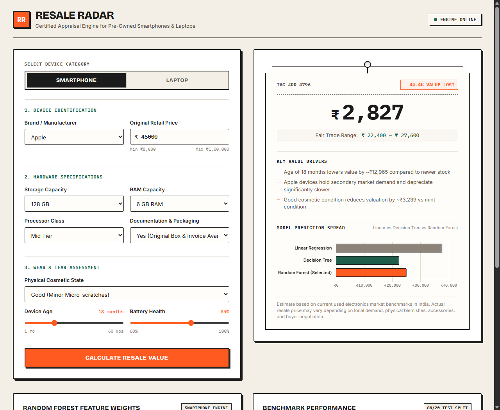
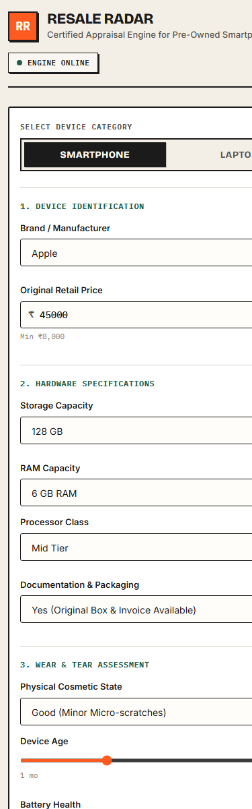

# ResaleRadar — Old Smartphone & Laptop Price Prediction System

**ResaleRadar** is an end-to-end, production-grade machine learning web application that estimates the fair resale market price (in Indian Rupees, ₹) of pre-owned smartphones and laptops based on their brand, technical specifications, age, and physical condition.

Designed with an aesthetic inspired by vintage classifieds shop counters and physical price tags, the system provides transparent valuation ranges, multi-model consensus predictions, and human-readable explanations of key price drivers.

---

## Visual Previews

| Desktop Valuation Interface (1280px) | Mobile Responsive Layout (375px) |
|:---:|:---:|
|  |  |

---

## Key Features

- **Multi-Device Support**: Dedicated valuation engines for smartphones (8 brands) and laptops (7 brands).
- **Consensus Modeling**: Trains and evaluates **Linear Regression**, **Decision Tree**, and **Random Forest Regressors**; deploys the best-performing model based on test RMSE while presenting real-time comparisons from all three models.
- **Fair Trade Range**: Provides lower and upper confidence bounds computed directly from the model's test Mean Absolute Error ($\pm \text{MAE}$).
- **Automated What-If Explanations**: Generates the top 3 plain-English valuation drivers by evaluating counterfactual spec and condition differentials.
- **Interactive Single-Page UI**: Chunky segmented tabs, live-updating range sliders, count-up price animations, and Chart.js horizontal bar charts.
- **Single Deployable Unit**: FastAPI serves both the REST API endpoints and static frontend assets without external build tools.

---

## Model Benchmark Performance

Models were trained on an 80/20 train/test split (`random_state=42`) with preprocessing via `ColumnTransformer` (OneHotEncoding for categoricals, StandardScaler for numerics):

| Device Type | Model Architecture | MAE (₹) | RMSE (₹) | R² Score | Status |
|:---|:---|:---:|:---:|:---:|:---:|
| **Smartphone** | Linear Regression | ₹ 6,539.28 | ₹ 8,321.35 | 0.9079 | Baseline |
| **Smartphone** | Decision Tree (Tuned) | ₹ 3,688.23 | ₹ 6,231.49 | 0.9483 | Candidate |
| **Smartphone** | **Random Forest (n=200)** | **₹ 2,559.12** | **₹ 4,159.78** | **0.9770** | **Selected (Best)** |
| **Laptop** | Linear Regression | ₹ 12,291.44 | ₹ 15,553.42 | 0.9043 | Baseline |
| **Laptop** | Decision Tree (Tuned) | ₹ 7,211.33 | ₹ 10,025.88 | 0.9602 | Candidate |
| **Laptop** | **Random Forest (n=200)** | **₹ 5,257.65** | **₹ 7,712.90** | **0.9765** | **Selected (Best)** |

---

## Local Quickstart (3 Commands)

Run the application locally in 3 commands:

```bash
# 1. Clone & navigate into project
cd ResaleRadar

# 2. Install dependencies
pip install -r requirements.txt

# 3. Start the application server
uvicorn app.main:app --host 0.0.0.0 --port 8000
```

Open `http://localhost:8000` in any web browser.

---

## How to Retrain Models

To regenerate the synthetic datasets and train updated ML pipelines:

```bash
python ml/generate_data.py && python ml/train.py
```

This updates:
- `data/smartphones.csv` (3,000 samples)
- `data/laptops.csv` (2,500 samples)
- `models/phone_model.joblib` & `models/laptop_model.joblib` (Best pipelines)
- `models/phone_all.joblib` & `models/laptop_all.joblib` (All candidate models)
- `models/metrics.json` (Error metrics & feature importances)

---

## Swapping In a Real Dataset (Kaggle / OLX / Cashify)

To train on real market data, place your CSV files in `data/` and match the following column schemas:

### Smartphone Schema (`data/smartphones.csv`)
- `brand` *(string)*: `Apple`, `Samsung`, `OnePlus`, `Xiaomi`, `Realme`, `Google`, `Vivo`, `Oppo`
- `original_price` *(numeric)*: Original purchase price in INR (e.g. 8000–150000)
- `age_months` *(numeric)*: Device age in months (1–60)
- `condition` *(string)*: `Like New`, `Good`, `Fair`, `Poor`
- `storage_gb` *(numeric)*: `64`, `128`, `256`, `512`
- `ram_gb` *(numeric)*: `3`, `4`, `6`, `8`, `12`, `16`
- `battery_health_pct` *(numeric)*: Battery maximum capacity percentage (60–100)
- `processor_tier` *(string)*: `Entry`, `Mid`, `Flagship`
- `has_box_and_bill` *(binary)*: `1` if original packaging and invoice exist, else `0`
- `resale_price` *(target numeric)*: Actual realized selling price in INR

### Laptop Schema (`data/laptops.csv`)
- `brand` *(string)*: `Apple`, `Dell`, `HP`, `Lenovo`, `Asus`, `Acer`, `MSI`
- `original_price` *(numeric)*: Original purchase price in INR (e.g. 25000–250000)
- `age_months` *(numeric)*: Device age in months (1–72)
- `condition` *(string)*: `Like New`, `Good`, `Fair`, `Poor`
- `storage_gb` *(numeric)*: `256`, `512`, `1024`, `2048`
- `storage_type` *(string)*: `SSD`, `HDD`
- `ram_gb` *(numeric)*: `4`, `8`, `16`, `32`
- `cpu_tier` *(string)*: `Core i3/Ryzen 3`, `Core i5/Ryzen 5`, `Core i7/Ryzen 7`, `Apple M-series`
- `gpu_type` *(string)*: `Integrated`, `Dedicated`
- `screen_size_in` *(numeric)*: `13.3`, `14.0`, `15.6`, `16.0`, `17.3`
- `battery_health_pct` *(numeric)*: Remaining battery capacity (50–100)
- `resale_price` *(target numeric)*: Actual realized selling price in INR

Once aligned, execute `python ml/train.py` to produce newly fitted model weights.

---

## API Reference

### 1. Health Check
- **Endpoint**: `GET /api/health`
- **Response**:
```json
{
  "status": "ok",
  "models_loaded": true
}
```

### 2. Available Options
- **Endpoint**: `GET /api/options`
- **Response**: Returns valid categories, allowable values, and min/max numeric ranges for both smartphone and laptop forms.

### 3. Model Performance Metrics
- **Endpoint**: `GET /api/metrics`
- **Response**: Full benchmark results (MAE, RMSE, R²) for all candidate architectures alongside top 8 feature importances.

### 4. Resale Price Prediction
- **Endpoint**: `POST /api/predict`
- **Headers**: `Content-Type: application/json`
- **Smartphone Payload Example**:
```json
{
  "device_type": "smartphone",
  "brand": "Apple",
  "original_price": 79900,
  "age_months": 18,
  "condition": "Good",
  "storage_gb": 128,
  "ram_gb": 6,
  "battery_health_pct": 86,
  "processor_tier": "Mid",
  "has_box_and_bill": 1
}
```
- **Response Example**:
```json
{
  "device_type": "smartphone",
  "estimated_price": 49300,
  "price_low": 46700,
  "price_high": 51900,
  "depreciation_pct": 38.3,
  "per_model_predictions": {
    "linear": 56200,
    "tree": 46600,
    "forest": 49300
  },
  "top_factors": [
    "Age of 18 months lowers value by ~₹22,169 compared to newer stock",
    "Apple devices hold secondary market demand and depreciate significantly slower",
    "Original invoice & retail box included improves buyer trust and price realization"
  ],
  "disclaimer": "Estimate based on current used electronics market benchmarks in India..."
}
```

---

## Testing

Run unit and integration test suite:

```bash
pytest -q
```

All tests validate:
- Server and model health endpoints
- Dynamic options retrieval
- Prediction accuracy and bounds logic
- Pydantic validation (invalid brands, out-of-bounds prices, invalid ages returning HTTP 422)

---

## Step-by-Step Render Deployment

1. **Push to GitHub**:
   Ensure all tracked model files and datasets are committed:
   ```bash
   git add .
   git commit -m "feat: complete ResaleRadar ML service"
   git push origin main
   ```

2. **Deploy on Render**:
   - Log in to your [Render Dashboard](https://dashboard.render.com/).
   - Click **New +** and select **Blueprint**.
   - Connect your GitHub repository.
   - Render automatically detects `render.yaml` and sets up the Docker Web Service.
   - Alternatively, choose **New Web Service**, select **Docker**, set Environment Variable `PORT=8000`, and set Health Check Path to `/api/health`.
   - Click **Create Web Service**. Render builds the image from `Dockerfile` and deploys it live on a free public HTTPS domain.

---

## Limitations & Honest Disclaimer

- **Calibrated Synthetic Data**: Training data was synthetically generated using domain-calibrated exponential depreciation rates and spec modifiers typical of the Indian secondary electronics market.
- **Subjective Valuation Nuances**: Algorithms cannot inspect micro-scratches, OLED screen burn-in, aftermarket replacement displays, or physical hinge tightness.
- **Regional & Platform Fluctuations**: Real-world selling prices fluctuate depending on whether the seller trades on platforms like OLX, Cashify, or Cash On Delivery classifieds with buyer negotiation margins.
